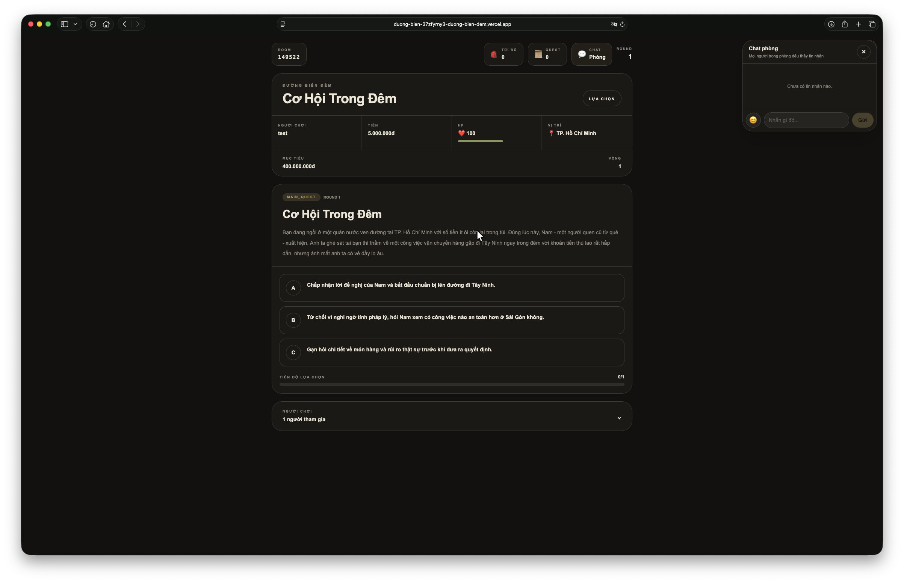

https://duong-bien-a3f7hgqvf-duong-bien-dem.vercel.app/

## Gameplay Preview

🌒 ĐƯỜNG BIÊN ĐÊM

One World. Many Stories. Every Choice Matters.

Đường Biên Đêm is an online multiplayer role-playing game where you start with nothing and work your way toward a better life in an unpredictable world.

There is no single path to success. Every decision creates new opportunities, but every opportunity comes with its own risks.

You can build your wealth, explore different opportunities, interact with other players, or simply try to survive another day.

The world doesn’t wait for you. Every choice has consequences.

⸻

🎮 About the Game

In Đường Biên Đêm, every player begins under the same circumstances:

* You are an orphan with no family or support.
* Your journey begins in Vietnam.
* You start with 5,000,000 VND.
* Your ultimate goal is to build a fortune worth 400,000,000 VND.

From there, your future is in your hands.

The world evolves through events, unexpected situations, and decisions. You are not alone in this journey — you can share the experience with your friends and create your own stories together.

👥 Multiplayer Experience

Đường Biên Đêm features online rooms where players can experience the world together.

* Up to 4 players per room.
* Create a room or join your friends.
* Each room has a unique 6-digit code.
* Game worlds remain active even when the room creator is offline.

You can also participate as a spectator or support role without being a main player.

📊 Your Character

Your journey is shaped by three important statistics:

Statistic	Description
💰 Money	Your current wealth and financial resources.
❤️ Health	Your character’s physical condition.
⚖️ Legal Risk	The level of legal trouble associated with your activities.

These statistics influence your situation and the opportunities available to you.

🤖 AI Storyteller

One of the key features of Đường Biên Đêm is its AI Host.

The AI Host acts as the storyteller of the game world. It brings situations to life by:

* Narrating events and situations.
* Introducing unexpected encounters.
* Presenting choices to players.
* Responding to the current state of the story.

However, the AI does not have the final say over game outcomes.

Important changes to money, health, and character statistics are handled by the game system itself. This keeps the experience consistent and ensures that decisions have clear consequences.

🏆 Your Goal

Your main objective is to reach a total fortune of 400,000,000 VND.

But getting rich is never that simple.

You will need to balance:

* Opportunities and risks.
* Short-term rewards and long-term consequences.
* Personal ambitions and relationships with other players.

Will you be the first to reach your goal, or will someone else get there before you?

🌐 How to Play

Đường Biên Đêm is designed to work on both mobile devices and computers.

Getting started is simple:

1. Visit the game website.
2. Create a new room or enter an existing room code.
3. Invite your friends.
4. Start your journey.

No additional software installation is required.

🛠️ About This Project

Đường Biên Đêm is an independent game project built around the idea of creating a persistent multiplayer world where players can develop their own stories through meaningful decisions.

Some of the project’s core principles:

* A persistent world that does not depend on the creator’s computer staying online.
* Real-time multiplayer interactions.
* AI-generated events and storytelling.
* A dedicated game system that manages important outcomes.
* A simple, mobile-first interface.

Built With

* Next.js – The foundation of the game.
* React – The user interface.
* Tailwind CSS – Visual design.
* Supabase – Player data and real-time interactions.
* AI Models – Storytelling and dynamic events.

⸻

🌑 One World. Many Destinies.

You don’t have to be the best when you start.

You just have to decide who you want to become by the end.

Welcome to Đường Biên Đêm.
